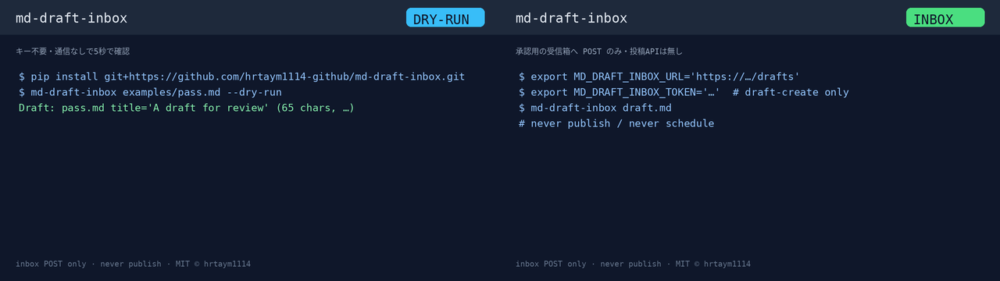

English: [README.en.md](README.en.md)
# md-draft-inbox

判定の次は人の受信箱。エージェントや日次ジョブが作った Markdown 下書きを、**人が読んで承認する inbox にだけ置く**小さな CLI です。

Send Markdown drafts to a human-approval inbox after your quality gate.  
**Never publish to X.** Never auto-approve or schedule. Inbox POST only.

[](docs/media/md-draft-inbox-howto.gif)

- 🎞️ [GIF](docs/media/md-draft-inbox-howto.gif)
- Release: [v0.1.0](https://github.com/hrtaym1114-github/md-draft-inbox/releases/tag/v0.1.0)

## 使い方（4ステップ）

1. **Install** — `pip install git+https://github.com/hrtaym1114-github/md-draft-inbox.git`
2. **Dry-run** — `md-draft-inbox examples/pass.md --dry-run`（通信・キー不要）
3. **Env（実送信時のみ）** — `MD_DRAFT_INBOX_URL` / `MD_DRAFT_INBOX_TOKEN`（下書き作成専用）
4. **結果** — 全ファイル成功 **exit 0** / いずれか失敗 **exit 1**

```sh
md-draft-inbox examples/pass.md --dry-run
# Draft: pass.md title='A draft for review' (65 chars, id=…)
```

## Install / インストール

Python ≥ 3.10。実行時依存なし（標準ライブラリのみ）。

```sh
# 見知らぬ人向け（推奨）
pip install git+https://github.com/hrtaym1114-github/md-draft-inbox.git

# 開発（このリポ）
python3 -m venv .venv
.venv/bin/pip install -e '.[dev]'
.venv/bin/md-draft-inbox examples/pass.md --dry-run
.venv/bin/pytest -q
```

`python -m md_draft_inbox` でも同じです。

## Configuration / 環境変数

| Variable | Live / 実送信 | Dry-run |
| --- | --- | --- |
| `MD_DRAFT_INBOX_URL` | 必須: inbox の draft-create URL | 未使用 |
| `MD_DRAFT_INBOX_TOKEN` | 必須: Bearer（下書き作成専用） | 未使用 |

設定ファイルは読みません。URL・トークンは環境変数のみ。投稿・予約用の広い権限トークンは渡さないでください。

## Usage / 使い方

```sh
# 通信なし
md-draft-inbox examples/pass.md --dry-run
md-draft-inbox examples/pass.md --dry-run --json

# 実送信（自分の inbox）
export MD_DRAFT_INBOX_URL='https://example.com/api/drafts'
export MD_DRAFT_INBOX_TOKEN='…'   # draft-create only
md-draft-inbox examples/pass.md

# 複数ファイル・本文見出し変更
md-draft-inbox first.md second.md --section Draft --adapter studio
```

### 抽出ルール

- **タイトル**: 先頭の `#` 見出し。無ければファイル名（拡張子なし）。100文字で切る
- **本文**: 既定は `## 投稿文`（`--section` で変更）。次の h2（フェンス外）まで
- 囲いの triple-backtick フェンスは外す。末尾の `---` は除去
- 見出しなし・空本文・フェンス未閉鎖・本文 20,000 文字超 → そのファイルは失敗

### Adapter `studio`（唯一・既定）

UTF-8 JSON を HTTP POST + Bearer で送ります。形は `{id, title, body, source}`。`source` はファイル名のみ。

安定 ID:

```python
uuid.uuid5(uuid.NAMESPACE_URL,
           'md-draft-inbox:' + filename + '\n' + title[:100] + '\n' + body)
```

ファイルを動かしても名前と抽出内容が同じなら ID は維持。原稿ファイルは変更しません。重複扱いは inbox 側。HTTP エラー／不正 JSON はそのファイル失敗。特定のレスポンスフィールドは必須にしません。

`--json` はファイルごとに `ok` / `path` / `dry_run`（成功時は `id` / `title` / `chars`、失敗時は `error`）。エラーは stderr にも出ます。失敗後も次のファイルを処理します。

## Exit codes / 終了コード

| Code | Meaning / 意味 |
| --- | --- |
| 0 | 全ファイル成功 |
| 1 | いずれか失敗 |
| 2 | 引数エラー |

## Non-goals / やらないこと

- X / Typefully などへの **投稿・予約 API**
- 自動公開・スケジュール
- LLM 添削・生成
- 決まったフォルダ構成の強制

## Related

上流の品質ゲート: [x-jev-gate](https://github.com/hrtaym1114-github/x-jev-gate)  
収集ゲート: [news-collect-validate](https://github.com/hrtaym1114-github/news-collect-validate)

MIT © 2026 hrtaym1114
